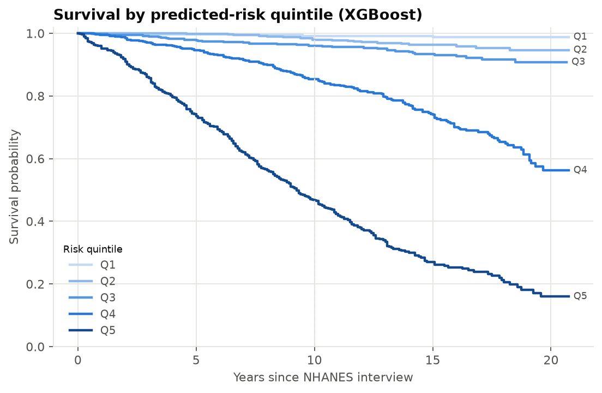
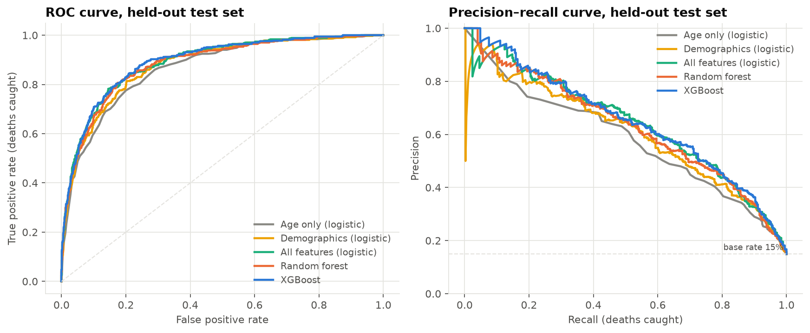
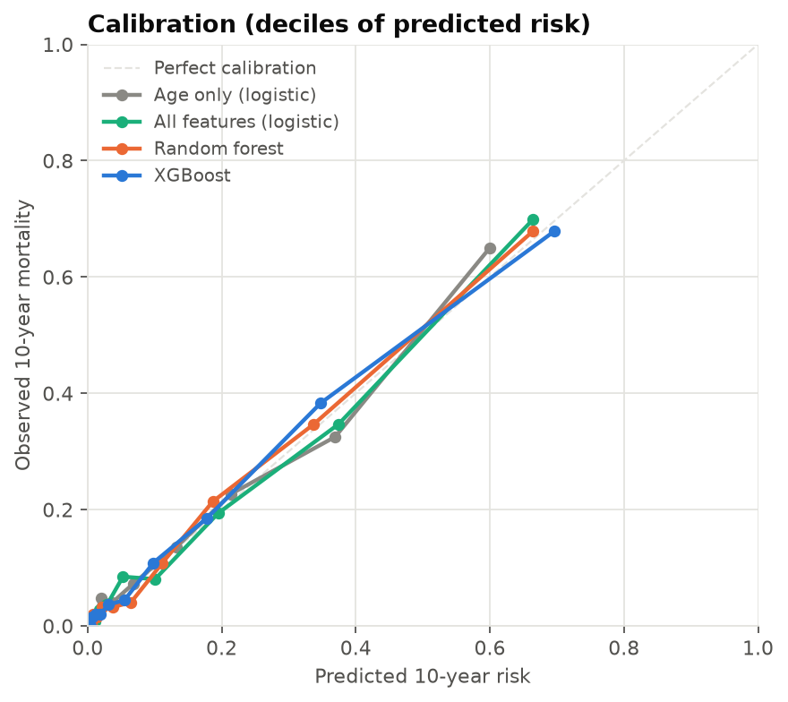
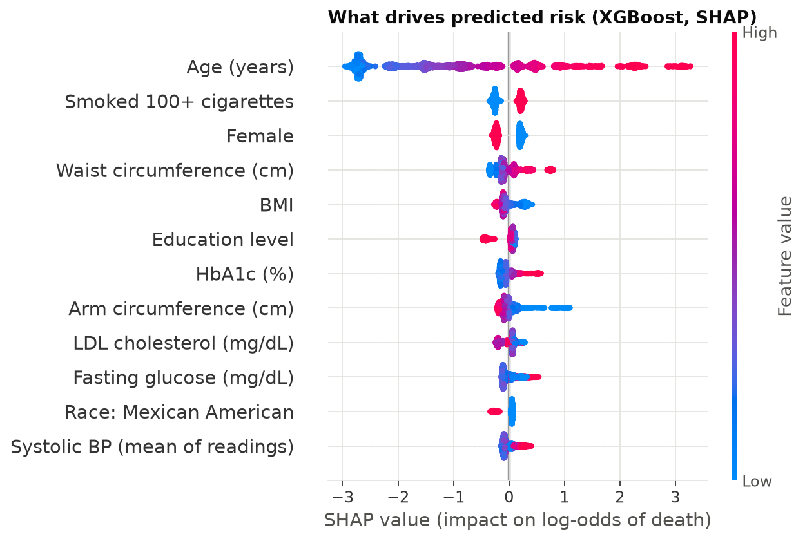

# How much does a health exam add to age in predicting 10-year mortality?

A 10-year all-cause mortality risk model built on **12,418 U.S. adults** from NHANES (1999–2008), linked to the CDC National Death Index. The model is benchmarked against an **age-only baseline**, checked for calibration, and validated against up to 20 years of follow-up.



*Test-set participants grouped by predicted 10-year risk. About 99% of the lowest-risk fifth were alive 20 years later, compared with about 16% of the highest-risk fifth. The model never saw follow-up beyond 10 years.*

## Key findings

| | ROC AUC (95% CI) | PR AUC | Brier | Precision on deaths* |
|---|---|---|---|---|
| Age only (logistic) | 0.865 (0.845–0.884) | 0.565 | 0.089 | 0.40 |
| Demographics + smoking (logistic) | 0.877 (0.858–0.895) | 0.606 | 0.086 | 0.44 |
| All features (logistic) | 0.889 (0.871–0.906) | 0.641 | 0.081 | 0.46 |
| Random forest | 0.883 (0.864–0.901) | 0.631 | 0.083 | 0.47 |
| **XGBoost** | **0.892 (0.874–0.909)** | **0.651** | **0.081** | **0.47** |

<sub>Held-out test set (n = 2,484, 14.9% died). *Precision at the threshold that catches about 77% of deaths, chosen on training data only. Bootstrap 95% CIs (1,000 resamples). Full table: [results/test_metrics.csv](results/test_metrics.csv).</sub>

1. **Age does most of the work.** Age alone gets ROC AUC 0.865. Adding body measurements, blood pressure and blood labs raises it by about **+0.02–0.03**, a gain that is statistically real but modest.
2. **XGBoost doesn't beat logistic regression.** The gap is +0.003 AUC, with a 95% CI that spans zero. At equal accuracy, the transparent model is the one to deploy.
3. **The probabilities can be trusted.** Every model is well calibrated (Brier ≈ 0.08), so a predicted 30% risk corresponds to roughly 30% observed mortality.
4. **Body shape beats body size.** A large waist raises risk, while low BMI and thin arms (markers of frailty) *also* raise it. Smoking, male sex, lower education and high HbA1c add risk too.
5. **The model's blind spot is younger adults.** It catches only about 1 in 10 deaths under age 55, which are often sudden rather than cardiometabolic.

| ROC & precision–recall | Calibration | SHAP feature effects |
|---|---|---|
|  |  |  |

## Approach

- **Outcome.** Death from any cause within 120 months of the NHANES interview. Only survey cycles where **every survivor was followed for the full 10 years** are used; see [the labelling-bias note](#what-changed-from-the-original-course-project).
- **Features.** 18 features: age, sex, race/ethnicity, education, smoking history, BMI, waist, height, leg length, arm circumference, systolic and diastolic BP, triglycerides, LDL, total cholesterol, HDL, fasting glucose and HbA1c. Units are harmonised across cycles and NHANES non-response codes are set to missing.
- **No leakage.** Every model is a scikit-learn `Pipeline` (median imputation + missing indicators → scaling/one-hot → model), so preprocessing is fit inside each CV fold.
- **Tuning.** 5-fold randomized search scored by **PR AUC**, because accuracy rewards predicting "survives" for everyone.
- **Honest evaluation.** A stratified 80/20 split, with the test set used once. The decision threshold is fixed from out-of-fold training predictions, and paired bootstrap tests compare each model against the age-only baseline.
- **Interpretation.** SHAP values, an error analysis by age band, and Kaplan–Meier curves by risk quintile.

## Repository

```
├── notebooks/
│   ├── 01_data_acquisition.ipynb       # download & merge NDI, NHANES, CDC WONDER
│   ├── 02_population_clustering.ipynb  # K-means / hierarchical / DBSCAN on population subgroups
│   └── 03_mortality_risk_model.ipynb   # ← main analysis (this README's results)
├── src/mortality/
│   ├── data.py       # cleaning, unit harmonisation, outcome definition
│   ├── models.py     # model pipelines + search spaces
│   ├── evaluate.py   # metrics, bootstrap CIs, paired AUC tests
│   └── train.py      # end-to-end experiment and figures
├── data/             # processed CSVs (NHANES + NDI linked; WONDER population table)
├── figures/          # generated plots
└── results/          # metrics tables, tuned params, saved XGBoost pipeline
```

## Reproduce

```bash
git clone https://github.com/helenachen03/us-mortality-risk-model.git
cd us-mortality-risk-model
python -m venv .venv && source .venv/bin/activate
pip install -r requirements.txt
pip install -e .

python -m mortality.train          # ~3 min: retrains every model and regenerates results/ and figures/
jupyter lab notebooks/03_mortality_risk_model.ipynb
```

macOS only: XGBoost needs OpenMP. Run `brew install libomp` first if `import xgboost` fails.

## Population clustering (notebook 02)

A separate population-level analysis using CDC WONDER mortality rates joined to NHANES averages by age group, sex and survey cycle (1,372 subgroups). K-means and hierarchical clustering (k = 3, bootstrap-stable) produce three profiles:

| Cluster | Profile | Mean mortality (per 100k) |
|---|---|---|
| 0 | Younger adults, low cardiometabolic risk | ~55 |
| 1 | Older females, moderate cardiometabolic risk | ~1,080 |
| 2 | Older males, elevated cardiometabolic burden | ~1,560 |

## What changed from the original course project

This started as a three-person Milestone II project in the University of Michigan MADS program ([original repo](https://github.com/helenachen03/mortality-rate-prediction)), with **David Ahn**, **Yinghui Chen** and **Travis Robinson**. Travis built the original data-acquisition and classification notebooks; Yinghui built the population clustering analysis. This repository is a follow-up rework of the individual-level model:

| Original | Now |
|---|---|
| Kept 2009–2018 participants, but those cycles could only contribute *deaths* to a 10-year label (every 2011–2017 row was a death) | Restricted to cycles with complete 10-year follow-up; checked automatically |
| Headline **F1 = 0.92**, measured on the *survivor* class (~85% of people) | Metrics for the **death** class, plus PR AUC, Brier score, specificity and CIs |
| `GridSearchCV` optimised accuracy on imbalanced data | Optimises PR AUC |
| Mean imputation outside CV; SVC/KNN on unscaled features; test set imputed with its own means | All preprocessing inside sklearn Pipelines |
| No baseline; "age is the dominant predictor" stated qualitatively | Quantified against an age-only model with paired bootstrap tests |
| No calibration or survival check | Calibration curves; Kaplan–Meier validation over 20 years |
| Colab-only paths, incomplete `requirements.txt` | Runs locally from a clean environment |

## Limitations

- **No NHANES survey weights.** Results describe this sample, not the U.S. population.
- **Older cohort.** Complete 10-year follow-up limits the data to 1999–2008 exams.
- **HDL is missing for 1999–2002**, because a variable name changed between cycles; this is handled with missing indicators.
- **Single-visit, exam-only features.** No diagnoses, medications or physical activity.
- **Binary label.** A survival model (Cox / XGBoost-AFT) could also use the 2009+ participants.

## Data sources

- [NHANES](https://www.cdc.gov/nchs/nhanes/): National Health and Nutrition Examination Survey, 1999–2018
- [NCHS Linked Mortality Files](https://www.cdc.gov/nchs/linked-data/mortality-files/index.html): 2019 public-use NDI linkage
- [CDC WONDER](https://wonder.cdc.gov/): underlying cause-of-death mortality rates, 1999–2020

## References

- Levantesi & Pizzorusso (2019). *Application of machine learning to mortality modeling and forecasting.* Risks 7(1):26. [doi:10.3390/risks7010026](https://doi.org/10.3390/risks7010026)
- Qiu et al. (2022). *Interpretable machine learning prediction of all-cause mortality.* Commun Med 2:125. [doi:10.1038/s43856-022-00180-x](https://doi.org/10.1038/s43856-022-00180-x)
- Williams et al. (2020). JSM Proceedings. [amstat.org](https://ww2.amstat.org/meetings/proceedings/2020/data/assets/pdf/1505462.pdf)
